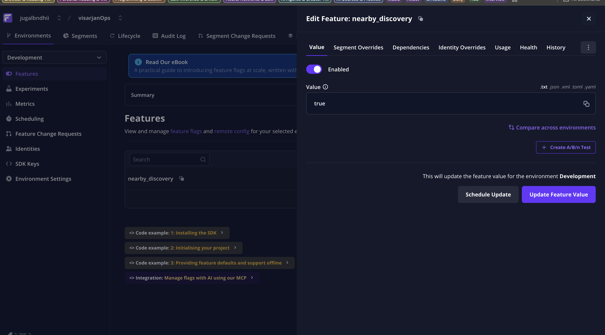
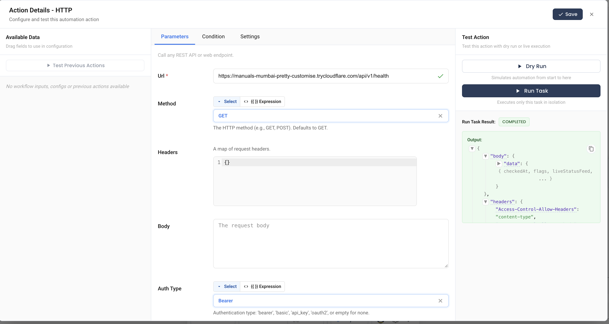

# How VisarjanOps uses the Festive Hacks sponsors

VisarjanOps uses all three sponsor tools, each for a job it is actually suited to:

| Sponsor | What it does in VisarjanOps | Where |
|---|---|---|
| **Sarvam AI** | Lets devotees search for immersion sites **by voice** in Marathi, Hindi, Kannada or English, and hear the nearest sites read back in their language | `server/sarvam.js`, Explore → **Ask by voice** |
| **Flagsmith** | Turns features on and off **without redeploying** (nearby discovery, map, voice, Apify import, staff workflows), with safe defaults if Flagsmith is down | `server/flags.js`, Operations → **Rollout controls** |
| **NudgeBee** | **Monitors the running app**: a NudgeBee automation calls our token-protected health endpoint over HTTPS | `GET /api/v1/health`, NudgeBee **Automations** |

---

## Sarvam AI: voice search in Indian languages

**The problem it solves:** many devotees, especially elders, find typing a site or area name in English hard. With Sarvam they can simply say it.

**How it works**

1. On Explore, the visitor taps **🎙 Ask by voice**. The microphone is requested only after this tap. Recording stops on a second tap or after 8 seconds.
2. The server sends the recording to **Sarvam Saaras v4** (speech-to-text, `mode: translate`), with Mumbai area names as *keyterms* so local place names are recognised. Sarvam returns the English meaning and the detected language.
   - Tested: Marathi “दादर जवळ विसर्जन तलाव दाखवा” → *“Show the Visarjan lake near Dadar.”*, language `mr-IN`.
3. VisarjanOps matches that text to a listed area, a Mumbai locality or a site name from **our own data**. Nothing else is inferred. Localities with no listed site, such as Dadar, are centred using OpenStreetMap Nominatim (only the locality name is sent).
4. The list and map jump to the nearest sites. **Sarvam Bulbul v4 Flash** (text-to-speech) then reads a short summary back **in the language the visitor spoke**. The spoken text comes from fixed templates and our own site data, never free text.

**Safeguards (credits and privacy)**

- Off unless `SARVAM_ENABLED=true`, `SARVAM_API_KEY` is set **and** the Flagsmith flag `voice_assistance` is on.
- Daily call cap (`SARVAM_DAILY_CALL_LIMIT`, default 150), 10 requests per visitor per 10 minutes, recordings ≤ 800 KB, and silent recordings rejected **before** any paid call. Voice routes only accept requests from the app itself.
- Audio and transcripts are **not logged or stored**. For a device location, the spoken answer includes no distances, so the visitor's position is never inferable from server traffic.
- The API key stays on the server in `.env`, never in the browser or the repository.
- Known limit: Hindi, Marathi and Kannada reply wording needs native-speaker review.

---

## Flagsmith: feature flags without redeploying

**The problem it solves:** on festival day, organisers need to switch features off instantly, for example voice search if credits run low, or the map on poor networks, without redeploying.

**How it works**

- Uses the **official `@flagsmith/nodejs` SDK** (9.5.0) in **local-evaluation** mode with a **server-side environment key** (`FLAGSMITH_SERVER_KEY`, starts with `ser.`).
- The SDK downloads the environment once and refreshes it every 60 seconds, so checking a flag never makes a network call per page or request (about 43k requests/month, within the free plan).
- Five flags:

| Flag | Controls | If Flagsmith is unavailable |
|---|---|---|
| `nearby_discovery` | “Use my location” and area sorting | On (existing feature) |
| `map_view` | Explore map (off = list only) | On |
| `apify_import` | Staff-triggered Apify import | On |
| `voice_assistance` | Sarvam voice search and spoken answers | **Off** (new, spends credits) |
| `ops_status_updates` | Staff live-status posts and gate QR check-in | **Off** (new staff workflow) |

- **Flags never replace security.** Every staff route checks the staff login first, then the flag. Live site data (status, crowd, capacity) stays in the app's own API, never in flags.
- Operations shows each flag's live state and when Flagsmith connected.
- Verified with the flags configured in the Flagsmith dashboard: with local fallbacks disabled, `voice_assistance` and `ops_status_updates` still read **on**, proving the values come from Flagsmith.

*Flagsmith dashboard, project visarjanOps, Development environment: the `nearby_discovery` flag enabled.*

---

## NudgeBee: monitoring the running app

**The problem it solves:** if VisarjanOps goes down during visarjan, devotees lose site and crowd information. NudgeBee lets the operations team find out first.

**How it works**

- VisarjanOps exposes **`GET /api/v1/health`**. It reports whether the service is up, whether site data is readable (216 sites), whether Flagsmith flags are loading, and Sarvam voice usage for the day, with **no secrets and no visitor data**.
- The endpoint requires `Authorization: Bearer <OPS_MONITOR_TOKEN>` (or a staff session). Without the token it returns **401**.
- For NudgeBee's cloud to reach the app during the hackathon, the local app is published over **HTTPS** with a temporary Cloudflare quick tunnel. This address changes whenever the tunnel restarts.
- In NudgeBee:
  1. Workspace approved; a **non-production self-hosted account** (`visarjanops-demo`) created.
  2. **Automations → New Automation**: **Manual Trigger** → **HTTP Request** task.
  3. URL `https://<tunnel>/api/v1/health`, method `GET`, auth type **Bearer**, token = `OPS_MONITOR_TOKEN`.
  4. **Run Task** → result **COMPLETED**, with the health data (`checkedAt`, `flags`, `liveStatusFeed`, …) in the response body. That data is only returned with the correct token.

*NudgeBee automation: the HTTP Request task calling `/api/v1/health` over HTTPS with Bearer auth; Run Task result **COMPLETED** with the app's health data.*

**Scope (stated honestly):** NudgeBee checks the **app's health**. It does not measure crowds or fix anything automatically. Crowd numbers come from bookings and gate QR scans. A **Schedule** trigger every 5 minutes and an alert when the status code isn't 200 are the next steps. For a permanent setup, the app needs a stable HTTPS deployment instead of the temporary tunnel, and the proxy-agent credentials created during setup should be rotated.

---

## Secrets and configuration

All keys live only in the server's git-ignored `.env` (see `.env.example` for names): `SARVAM_API_KEY`, `FLAGSMITH_SERVER_KEY`, `OPS_MONITOR_TOKEN`, staff login. They were checked against every tracked file and the branch history before each push; none is in the repository.
